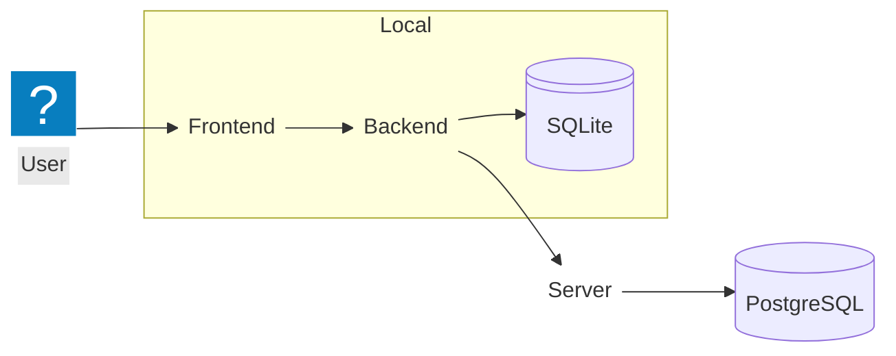

# Project Architecture

Project is a personal and team project planner.

For personal use it will only use Frontend, Backend and SQLite.

## Frontend

Frontend will be written in React + TypeScript.
Bun is the package manager for it

## Backend

Backend will be written in go

It will use SQLite for local database

## Server

Will be written in go

Will use PostgreSQL for team management and synchronizing devices