# Database Design

## Database Graph

```mermaid
erDiagram
    direction LR
    accounts {
        TEXT id PK
        TEXT user_id UK
        TEXT email UK
        TEXT password_hash
        DATETIME created_at
    }                

    users {
        TEXT id PK, FK
        TEXT display_name
        DATETIME created_at
        DATETIME updated_at
    }

    workspaces {
        TEXT id PK
        TEXT kind
        TEXT name
        DATETIME created_at
        DATETIME updated_at
        DATETIME deleted_at
    }

    memberships {
        TEXT id PK
        TEXT user_id FK
        TEXT workspace_id FK
        TEXT role
        DATETIME joined_at
        DATETIME left_at
        DATETIME updated_at
    }

    teams {
        TEXT id PK
        TEXT workspace_id FK
        TEXT name
        TEXT color
        DATETIME created_at
        DATETIME updated_at
        DATETIME deleted_at
    }

    team_members {
        TEXT workspace_id FK
        TEXT membership_id PK, FK
        TEXT team_id PK, FK
        TEXT role
        DATETIME added_at
        DATETIME updated_at
        DATETIME removed_at
    }

    invitations {
        TEXT id PK
        TEXT workspace_id FK
        TEXT invited_by FK
        TEXT email
        TEXT role
        TEXT token_hash UK
        DATETIME expires_at
        DATETIME accepted_at
        DATETIME revoked_at
        DATETIME created_at
    }

    projects {
        TEXT id PK
        TEXT workspace_id FK
        TEXT name
        TEXT description
        TEXT icon
        TEXT identifier
        INTEGER next_task_number
        DATETIME created_at
        DATETIME updated_at
        DATETIME archived_at
        DATETIME deleted_at
    }

    project_teams {
        TEXT workspace_id FK
        TEXT project_id PK, FK
        TEXT team_id PK, FK
        DATETIME added_at
        DATETIME updated_at
        DATETIME removed_at
    }

    statuses {
        TEXT id PK
        TEXT workspace_id FK
        TEXT plan_id FK
        TEXT title
        TEXT description
        TEXT color
        TEXT position
        DATETIME updated_at
        DATETIME deleted_at
    }

    tasks {
        TEXT id PK
        TEXT created_by FK
        TEXT project_id FK
        TEXT plan_id FK
        TEXT status_id FK
        TEXT parent_id FK
        TEXT title
        TEXT description
        TEXT position
        TEXT priority
        INTEGER number
        DATETIME start_date
        DATETIME completed_at
        DATETIME created_at
        DATETIME updated_at
        DATETIME deleted_at
    }

    task_events {
        TEXT id PK
        TEXT workspace_id FK
        TEXT task_id FK
        TEXT actor_id FK
        TEXT action
        TEXT details
        DATETIME created_at
        DATETIME updated_at
        DATETIME deleted_at
    }

    task_relations {
        TEXT workspace_id FK
        TEXT project_id FK
        TEXT task_id PK, FK
        TEXT related_task_id PK, FK
        TEXT kind
        DATETIME created_at
        DATETIME updated_at
        DATETIME removed_at
    }

    task_assignees {
        TEXT workspace_id FK
        TEXT task_id PK, FK
        TEXT membership_id PK, FK
        DATETIME assigned_at
        DATETIME updated_at
        DATETIME removed_at
    }

    labels {
        TEXT id PK
        TEXT workspace_id FK
        TEXT project_id FK
        TEXT name
        TEXT color
        TEXT position
        DATETIME created_at
        DATETIME updated_at
        DATETIME deleted_at
    }

    task_labels {
        TEXT workspace_id FK
        TEXT project_id FK
        TEXT task_id PK, FK
        TEXT label_id PK, FK
        DATETIME created_at
        DATETIME updated_at
        DATETIME removed_at
    }

    task_comments {
        TEXT id PK
        TEXT workspace_id FK
        TEXT task_id FK
        TEXT author_id FK
        TEXT body
        DATETIME created_at
        DATETIME updated_at
        DATETIME deleted_at
    }

    plans {
        TEXT id FK
        TEXT workspace_id FK
        TEXT project_id FK
        TEXT team_id FK
        TEXT name
        TEXT description
        TEXT icon
        DATETIME created_at
        DATETIME updated_at
        DATETIME archived_at
        DATETIME deleted_at
    }

    accounts ||--|| users : "has profile"
    users ||--o{ memberships : "joins"
    workspaces ||--o{ memberships : "contains"
    workspaces ||--o{ teams : "contains"
    workspaces ||--o{ projects : "contains"
    workspaces ||--o{ invitations : "has"
    workspaces ||--o{ project_teams : "contains"

    memberships ||--o{ invitations : "creates"
    memberships ||--o{ team_members : "belongs to teams"
    teams ||--o{ team_members : "has members"
    
    projects ||--o{ project_teams : "assigned teams"
    projects ||--o{ tasks : "contains"
    teams ||--o{ project_teams : "works on"

    project_teams ||--o{ plans : "has"
    projects ||--o{ plans : "has"
    plans ||--o{ tasks : "contains"
    plans ||--o{ statuses : "contains"
    statuses ||--o{ tasks : "categorizes"

    memberships ||--o{ task_assignees : "assigned tasks"
    tasks ||--o{ task_assignees : "has assignees"

    tasks o|--o{ tasks : "parent-child"
    tasks ||--o{ task_comments : "has comments"
    projects ||--o{ labels : "defines"
    tasks ||--o{ task_labels : "carries"
    labels ||--o{ task_labels : "tags"
    tasks ||--o{ task_events : "logs"
    memberships ||--o{ task_events : "acts"
    tasks ||--o{ task_relations : "relates to"
    memberships ||--o{ task_comments : "writes"

    workspaces ||--o{ resources : "contains"
    resources o|--o{ resources : "parent-child"
    tasks ||--o{ task_resources : "links"
    resources ||--o{ task_resources : "linked to"
    resources ||--o{ resource_events : "has activity"
    memberships ||--o{ resource_events : "acts"
    resources ||--o| resource_repositories : "filled by"
    resource_repositories ||--o| repository_checkouts : "local copy"
    resource_repositories ||--o{ repository_clones : "cloned to"
    users ||--o{ user_settings : "has"

    users ||--o{ ai_connections : "configures"
    users ||--o{ ai_chats : "owns"
    ai_connections ||--o{ ai_chats : "last used by"
    ai_chats ||--o{ ai_messages : "contains"
    ai_connections ||--o{ ai_messages : "answered with"
    ai_messages ||--o{ ai_message_attachments : "attaches"
```

## 1. General Structure

The same logical schema exists in two physical databases.

|          | Local                                                                                                      | Server                                                   |
| -------- | ---------------------------------------------------------------------------------------------------------- | -------------------------------------------------------- |
| Engine   | SQLite (`modernc.org/sqlite`, `database/sql`, no ORM (Object-Relational Mapping))                          | PostgreSQL                                               |
| Scope    | The user's own device                                                                                      | Team workspaces, accounts, invitations, synchronization |
| Tables   | users, workspaces, memberships, teams, team_members, projects, project_teams, plans, statuses, tasks, task_assignees, task_comments, task_events, task_relations, labels, task_labels, resources, task_resources, resource_events, resource_repositories, repository_checkouts, repository_clones, user_settings, ai_connections, ai_chats, ai_messages, ai_message_attachments | All local tables except repository_checkouts and repository_clones, plus accounts and invitations |

DDL (Data Definition Language) is maintained in two separate directories: `migrations/sqlite` and `migrations/postgres`. The logical schema is the same; only type mappings and language-specific differences vary.

Assumption: For workspaces where `kind = team`, the server is the source of truth, and the local database acts as a cache. For `kind = personal` workspaces, the server is just for backing up data for synchronizing data across devices.

## 2. Concepts

| Concept    | Definition |
| ---------- | ---------- |
| User       | Identity. Even a user without an account has a user record. When an account is created, `users.id` remains unchanged, so the IDs of records associated with that user never need to be rewritten. |
| Account    | Login credentials (email address and password hash). Exists only on the server and is not synchronized. A user can have at most one account. |
| Workspace  | Authorization and synchronization boundary. A `personal` workspace has a single member and works without an account. A `team` workspace supports multiple members. Every synchronized row carries a `workspace_id`. |
| Membership | A user's role in a workspace: `owner`, `admin`, `member`, or `viewer`. Leaving a workspace is recorded using `left_at`; the row is not deleted. |
| Team       | A permanent group of people within a workspace (Backend, Frontend, Mobile). Teams are flat; nested teams are not supported. |
| Project    | A unit of work belonging to a workspace. It is associated with one or more teams and contains one or more plans. |
| Plan       | A board inside a project. `team_id IS NULL` means the plan covers the whole project; otherwise it belongs to one team of that project. Statuses and tasks belong to a plan. |
| Status     | A Kanban column belonging to a plan. The `category` field labels the column: `todo`, `in_progress`, or `done`. It does not decide whether a task is finished; `tasks.completed_at` does. |
| Task       | A unit of work within a plan and a status. The owning team is derived from the plan. |
| Subtask    | A task with `parent_id` set. Subtasks are one level deep. A subtask in its parent's plan is shown inside the parent (as a checklist item) rather than on the board; a subtask in another plan is that plan's share of the work and stays on that plan's board. |
| Comment    | A plain-text note a member leaves on a task. Only its author may edit or delete it. |

### 2.1 Team Model

Teams are scoped to a workspace, and team memberships are also scoped to a workspace. There are three distinct relationships:

| Relationship                         | Table           | Meaning |
| ------------------------------------ | --------------- | ------- |
| Which person belongs to which team  | `team_members`  | A person can belong to multiple teams. |
| Which team works on which project   | `project_teams` | A project can be associated with multiple teams, and a team can be associated with multiple projects. |
| Which team a plan is dedicated to   | `plans.team_id` | A plan has a single optional team. `NULL` means the plan covers the whole project. |

Rules:

- "Members of the Backend team on a project" are not stored in a separate table. This information is derived by joining `project_teams` with `team_members`.
- A task's team is the team of its plan. Tasks do not carry their own `team_id`.
- If work involves multiple teams, it should be split into subtasks using `parent_id`. A subtask must be in the same project as its parent but may be in a different plan, which is how a task is split across team plans. A multi-team ownership model is intentionally not supported.
- An assignee (`task_assignees`) does not have to belong to the plan's team. Enforcing this requirement would invalidate assignments when a person leaves a team.
- Limitation: Because team membership is scoped to the workspace, the model cannot express that "Alice is on the Backend team for project A but not for project B." If this requirement arises, a separate project-level membership table can be added.

## 3. Conventions

| Topic | Rule |
| ----- | ---- |
| ID | UUIDv7 (Universally Unique Identifier), generated in Go using `model.NewID()`. The database does not generate IDs. SQLite uses `TEXT`; PostgreSQL uses `uuid`. |
| Time | Always UTC. SQLite stores timestamps as RFC 3339 `TEXT` (for example, `2026-10-28T12:00:00Z`), while PostgreSQL uses `timestamptz`. Local time zones are not stored. |
| Deletion | Soft deletion. Entity tables use `deleted_at`, relationship tables use `removed_at`, and memberships use `left_at`. Projects and plans can additionally be archived with `archived_at`. Physical deletion is performed only by an explicit cleanup (purge) job. |
| Foreign key deletion behavior | `ON DELETE` is not specified; the default behavior (restricting deletion) remains in effect. |
| Re-adding relationships | If a relationship row already exists, `removed_at` is cleared instead of inserting a new row. This prevents primary key conflicts and loss of history. |
| Ordering | `position` is a fractional index stored as `TEXT`. Moving an item updates only a single row. |
| Enums | `TEXT` with a `CHECK` constraint. |
| Synchronized tables | All of them carry `workspace_id` and `updated_at`. |
| SQLite | `PRAGMA foreign_keys = ON` is specified as a DSN (Data Source Name) parameter, and tables are defined as `STRICT`. |
| Email | Stored in lowercase-normalized form. |

## 4. Consistency Rules

### 4.1 Rules Enforced by the Database

| Rule | Mechanism |
| ---- | --------- |
| A row cannot reference a row belonging to another workspace. | Composite foreign key: `(x_id, workspace_id)` → `(id, workspace_id)`. The referenced tables have a unique index on `(id, workspace_id)` to support this. |
| A plan's team must be associated with the plan's project. | `plans (project_id, team_id)` → `project_teams (project_id, team_id)`. If `team_id` is `NULL`, the constraint is not checked. |
| A plan belongs to a project of the same workspace. | `plans (project_id, workspace_id)` → `projects (id, workspace_id)`. |
| A status belongs to a plan of the same workspace. | `statuses (plan_id, workspace_id)` → `plans (id, workspace_id)`. |
| A task's status must be in the task's plan. | `tasks (status_id, plan_id)` → `statuses (id, plan_id)`. |
| A task's plan must be in the task's project. | `tasks (plan_id, project_id)` → `plans (id, project_id)`. |
| A subtask and its parent are in the same project. | `tasks (parent_id, project_id)` → `tasks (id, project_id)`. The plan may differ. |
| A task's priority is one of `urgent`, `high`, `medium`, `low`, `none`. | `tasks.priority` is `NOT NULL DEFAULT 'none'` with a `CHECK` on those values. The service rejects anything else with `ErrInvalidPriority` (invalid input, HTTP 400) on create, update and import. An export made before priorities existed has none, and its tasks import as `none`. |
| A project has an identifier and its tasks have numbers, together a task key such as `ABC-12`. | `projects.identifier` is 2 to 5 characters, a letter then letters or digits, uppercase (`^[A-Z][A-Z0-9]{1,4}$`), unique among the workspace's live projects (partial unique index). A new project gets the first up to three ASCII letters of its name (`PRJ` when there are fewer than two), with a number appended when taken (`KIT`, `KIT2`). It can be changed; an invalid value is invalid input (400) and a taken one is `ErrIdentifierTaken` (409). Deleting a project frees its identifier. |
| A task number is unique in its project and never reused. | `tasks.number` is set when the task (or subtask) is created, from `projects.next_task_number`, which is read and advanced in the same transaction. `(project_id, number)` is unique, deleted tasks keep theirs. Migration 011 numbered existing tasks in creation order and derived identifiers for existing projects the same way. |
| Search finds a task by its key. | A search query that looks like a key (`abc-12`, case-insensitive) puts that live task first in the task results. |
| A label belongs to a project, and a task only carries labels of its own project. | `labels (project_id, workspace_id)` → `projects (id, workspace_id)`. `task_labels (task_id, project_id)` → `tasks (id, project_id)` and `task_labels (label_id, project_id)` → `labels (id, project_id)`, so the composite foreign keys make a label of another project impossible. |
| A label name is unique within its project; its colour is one of a fixed palette. | Partial unique index on `labels (project_id, name) WHERE deleted_at IS NULL`; a taken name is `ErrLabelNameTaken` (conflict, 409). The service accepts only `gray`, `red`, `orange`, `amber`, `emerald`, `teal`, `blue`, `indigo`, `violet`, `pink` (invalid input, 400) and a name of 1 to 50 characters. |
| A task's label set is replaced as a whole. | `PATCH /api/tasks/{id}` with `label_ids`: labels not in the list get `removed_at`, new ones are inserted, a label that comes back has `removed_at` cleared (the same row). Ids that are not live labels of the task's project are invalid input (400). Task lists report `label_ids` in label order. |
| Deleting a label. | The label gets `deleted_at` and its open `task_labels` rows get `removed_at`, in one transaction. Deleting a task, plan, status or project closes the `task_labels` rows of the tasks it deletes, and deleting a project also deletes its labels. |
| A task may have a start date, never after its due date. | `tasks.start_date` is nullable (RFC 3339 like `due_date`). When both dates are set, `start_date <= due_date`; the service rejects a violation with `ErrInvalidDateRange` (invalid input, 400) on create, update and import. |
| Every change to a task is logged. | `task_events (task_id, workspace_id)` → `tasks (id, workspace_id)`, `task_events (actor_id, workspace_id)` → `memberships (id, workspace_id)`. The task service writes one row per changed field (`created`, `renamed`, `described`, `status_changed`, `priority_changed`, `due_changed`, `start_changed`, `labels_changed`, `done`, `reopened`, `relation_added`, `relation_removed`) in the same transaction as the change. `details` is a JSON object of strings (`from`, `to`, and for relations `kind` and `task`, the other task's title). Rows are append-only; `deleted_at` is set when the task is deleted or the data is reset. |
| Tasks can be related; relations may cross projects of the workspace. | `task_relations (task_id, workspace_id)` and `(related_task_id, workspace_id)` → `tasks (id, workspace_id)`, `PRIMARY KEY (task_id, related_task_id)`, `CHECK (task_id <> related_task_id)`, `kind` one of `blocks` (task blocks related), `relates`, `duplicates` (task duplicates related). The service rejects a pair that already has a live relation in either direction with `ErrRelationExists` (conflict, 409). "Blocked by" and "duplicated by" are read-time views of the reverse side; `relates` reads the same from both tasks. Removing sets `removed_at`; adding again clears it. A task counts as blocked while a live `blocks` relation points at it from an open (not completed, not deleted) task. Deleting a task closes its relations. |
| A comment belongs to a task and an author of the same workspace. | `task_comments (task_id, workspace_id)` → `tasks (id, workspace_id)`, `task_comments (author_id, workspace_id)` → `memberships (id, workspace_id)`. |
| A comment body is not empty. | `CHECK (length(body) > 0)`. |
| A resource, its parent, its task links and its events belong to the same workspace. | Composite foreign keys on `(resource_id / parent_id, workspace_id)`. |
| Live sibling resource names are unique case-insensitively. | Partial unique index on `(workspace_id, COALESCE(parent_id, ''), name_key) WHERE trashed_at IS NULL AND deleted_at IS NULL`; `name_key` is the lowercased name. |
| A trashed resource knows what it was trashed with. | `CHECK ((trashed_at IS NULL) = (trashed_root_id IS NULL))`. |
| A repository row belongs to a folder of the same workspace. | `resource_repositories (resource_id, workspace_id)` → `resources (id, workspace_id)`. |
| A copy that is ready names its commit; a pending one has none. | `CHECK (state != 'ready' OR commit_sha IS NOT NULL)`, `CHECK (state != 'pending' OR commit_sha IS NULL)`. |
| A folder has no content fields. | `CHECK (kind = 'file' OR (mime_type IS NULL AND size = 0 AND is_text = 0))`. |
| Plan names are unique within a project and team scope. | Partial unique index on `(project_id, COALESCE(team_id, ''), name) WHERE deleted_at IS NULL`. |
| Team names are unique within a workspace. | Partial unique index: `WHERE deleted_at IS NULL`. |
| A user can have only one membership in a given workspace. | Unique constraint on `(workspace_id, user_id)`. |
| Enum values must be valid. | `CHECK` constraint. |

### 4.2 Rules Enforced by the Service Layer

All of these rules are protected by unit tests.

| Rule | Notes |
| ---- | ----- |
| Each user can have one `personal` workspace. | Teams cannot be created in a `personal` workspace. |
| The last `owner` cannot leave or have their role downgraded. | |
| A member who has left (`left_at` is set) cannot be assigned to a team or a task. | When a member leaves, the corresponding `team_members` and `task_assignees` rows are closed within the same transaction. |
| A subtask cannot create a cycle. | Subtasks are one level deep: a subtask cannot get subtasks of its own (rejected as invalid input), which also rules out cycles on creation. |
| Creating a subtask. | It goes into the parent's plan, in the plan's first `todo` status, and the creator is assigned, like any new task. The parent must exist and not be deleted. |
| Board and upcoming lists leave out nested subtasks. | A subtask whose non-deleted parent is in the same plan is listed only under its parent. Each board task reports its direct subtask count, finished subtask count and comment count. |
| Completing or reopening a task (`done` toggle). | Sets `completed_at` to the current time, or clears it when reopened. The task's status and position are left alone. A task already in the wanted state is left untouched. |
| A task is finished exactly while `completed_at` is set. | Independent of its status: moving a task into (or out of) a `done`-category status does not finish (or reopen) it. Plan done counts, finished subtask counts and the upcoming list all go by `completed_at`. |
| Comment body. | Trimmed; empty is rejected; at most 10 000 code points. |
| Only the author edits or deletes a comment. | Others get `forbidden`. Deleting is soft (`deleted_at`). |
| Creating a project creates a default whole-project plan with the default statuses. | Done in one transaction. |
| Creating a plan creates the default statuses for it. | Done in one transaction; a name already used by a non-deleted plan in the same project and team scope (archived included) is rejected with a conflict before the unique index is hit. |
| A task created without an explicit plan goes into the project's default plan. | The default plan is the oldest non-deleted, non-archived plan with `team_id IS NULL`. |
| When a team is removed from a project or deleted. | The plans of that team within the affected project are archived (`archived_at`) within the same transaction. The foreign key cannot see soft removal. |
| When a plan is deleted. | Its `statuses`, `tasks` and their `task_comments` rows are individually marked with `deleted_at` within the same transaction. |
| A project keeps at least one whole-project plan. | Deleting the project's last non-deleted, non-archived plan with `team_id IS NULL` is rejected with a conflict, so tasks created without an explicit plan always have a default plan. |
| Renaming a plan keeps plan names unique. | Same check as plan creation, scoped to the plan's own project and team and excluding the plan itself. |
| A project or plan icon is a single emoji. | Trimmed; empty means no icon and is stored as `NULL`. At most 8 code points, with no letters, digits, ASCII characters or whitespace, so an emoji with skin tone, ZWJ sequence or flag fits but text does not. |
| When a project is deleted. | Its `plans`, `statuses`, `tasks`, `task_comments` and `project_teams` rows are individually marked with `deleted_at` / `removed_at` within the same transaction. The system does not rely on the parent being hidden, because each row needs its own deletion record for synchronization. |
| Moving a task to another plan. | The status is mapped to a status of the target plan, because status IDs belong to a single plan. |
| Every plan has at least one `done`-category status. | Plan creation always inserts the default `Done` status. Deleting the plan's last `done` status is rejected with a conflict; any future category change must reject it too. |
| Reordering or moving a task within its plan. | Only the moved row is written: its `position` becomes the midpoint (`position.Between`) of its new neighbours in the target status. The target status must belong to the task's plan. |
| Reordering a status within its plan. | Only the moved row is written: its `position` becomes the midpoint (`position.Between`) of its new neighbours among the plan's non-deleted statuses. Tasks keep their `status_id` and `position`. |
| Editing a status. | Only `title`, `description` and `color` can be changed (`#rrggbb`, stored lowercase); the status must belong to the plan in the URL. `category` and `position` are left untouched, so the "at least one `done` status" rule cannot be broken by an edit. |
| Deleting a status. | The status, its tasks and all of their subtasks (even those in other statuses) and their comments are individually marked with `deleted_at`, and their open `task_assignees` rows get `removed_at`, within the same transaction. The status must belong to the plan in the URL, and the plan's last `done`-category status cannot be deleted. |
| When a task is deleted. | The task, all of its subtasks and their comments are marked with `deleted_at`, and their open `task_assignees` and `task_resources` rows get `removed_at`, within the same transaction. Deleting a plan, status or project closes the `task_resources` rows of its tasks the same way. |
| Resource names. | Trimmed; 1–255 bytes of UTF-8; no `/ \ : * ? " < > \|` or control characters; not `.` or `..`. `.yap-trash` and `.yap-repos` are reserved at the top of the tree (they are the trash and repository directories on disk). |
| Repository folders are read-only. | Nothing can be created, uploaded, moved, pasted or imported into a folder that has a `resource_repositories` row (`read_only`, 409), and a repository folder (or a folder holding one) cannot be copied. Renaming, moving, trashing, restoring, purging and task links work as for any folder. |
| Adding a repository. | Needs a connected GitHub account. The repository is looked up by `owner/name`; its id (which survives renames), default branch and URL are stored with the new folder (named after the repository; a taken name gets a ` (n)` suffix) in one transaction, logged as `created` with the repository name. The files are then fetched in the background. |
| Fetching and updating a copy. | Each device keeps its copy under `RESOURCES_PATH/<workspace_id>/.yap-repos/<resource_id>/` and its state in `repository_checkouts`. An attempt looks the repository up by id (storing a new name or URL), reads the branch head, and only downloads when the commit changed or the copy is missing. The ZIP is unpacked into a temporary directory and swapped in (at most 1 GiB downloaded, 2 GiB and 200 000 files unpacked; links and paths leaving the directory are skipped). A copy still holding a `.git` directory (a clone kept by the first version, reset by migration 009) is downloaded again. A failure keeps the copy and records `offline`, `unauthorized`, `not_found`, `too_large` or `failed`; a rejected token is forgotten. Without a token public repositories still update. Trashed repositories are not updated. |
| Cloning to the user's computer. | Needs the git program. The target is a new folder (a valid resource name) inside an existing folder given as an absolute path; a taken name is a conflict. A full `git clone` of the repository's current clone URL is made with the token passed in the environment, so it is neither on the command line nor stored in the clone (later pulls of private repositories use the user's own credentials). A failed clone removes what it left. The clone is recorded in `repository_clones`; the app never runs anything in it afterwards. The list shows whether each clone's `.git` is still there; removing one from the list only sets `deleted_at`. Only JSON requests are accepted, so another site cannot trigger a clone through the browser. |
| Commit history. | `GET /api/resources/{id}/repository/commits?page=` passes a page (1 to 100, 50 commits each) of the branch's history straight from GitHub, newest first, with parents, so the client can draw the graph. Nothing is stored; without GitHub it answers `github_unavailable`. Public repositories work without an account. |
| Picking the clone folder. | `GET /api/local-folders?path=` lists the subfolders (hidden ones left out, links to folders included) of an absolute path, or of the home folder when empty, with its parent (none at the root). |
| Background updates. | While the app runs: a pending copy is tried every minute whatever the settings say; with `repositories.auto_update` on, a ready copy is checked every 15 minutes, or every minute after an `offline` failure. "Update now" works with the setting off. Copies whose folder was purged are removed. A `fetching` state left by a stop is cleared on start. |
| Browsing a copy. | Paths are `/`-separated inside the repository; empty, `.` and `..` segments, backslashes and NUL are rejected, the copy is opened as an `os.Root` (no link can leave it), and a top-level `.git` directory is never shown. Folders are listed folders first, then by name; whether a file is text is sniffed from its first 8 KiB. |
| Name conflicts on create, upload, move and copy. | `fail` (409), `keep_both` (first free `name (n).ext`) or `replace`. Replace is only file over file: an upload gives the existing file the new content (it keeps its id and task links); a move or copy moves the existing file to the trash. Restoring from the trash always uses `keep_both`. |
| A folder cannot be moved or copied into itself or its descendants. | Rejected as invalid input. |
| Trash. | Trashing marks the item and its live descendants with `trashed_at` and `trashed_root_id` = the item. Only items with `trashed_root_id = id` are listed in the trash. Restoring brings back exactly that group, into the original folder, or to the top when that folder is no longer live. Task links stay while an item is trashed and are shown as trashed. |
| Purge (permanent delete). | Only for trash roots, one by one or by emptying the trash. The bytes are removed from the disk; the rows get `deleted_at` and stay as tombstones so the activity log and synchronization still see them; their open `task_resources` rows get `removed_at`. |
| Editing a text file. | The save carries the revision it was based on; a different stored revision is rejected as `stale` (409). Every content change bumps `revision`. Content must be valid UTF-8 without NUL bytes and at most 20 MiB. Uploads are at most 100 MiB. |
| Activity log. | Every change to a resource writes a `resource_events` row in the same transaction. Saves of the same file by the same member less than 10 minutes after the previous one extend that member's last `edited` event (`updated_at`, `details`) instead of adding a row. Link and unlink events carry `task_id`. |
| User settings. | Known keys: `resources.autosave_enabled`, `resources.autosave_delay_ms` (300 to 10 000), `tasks.hide_done`, `tasks.done_to_bottom`, `statuses.default_name.{todo,in_progress,done}` (trimmed, 1 to 100 characters), `notifications.due_soon`, `notifications.reminder` (`1h`, `1d` or `1w`), `notifications.overdue`, `notifications.comments`, `notifications.sound`, `repositories.auto_update`. An update with any invalid value writes nothing. Unknown or unreadable stored values fall back to the defaults (autosave on, 1000 ms; completed tasks shown in place; statuses "To Do", "In Progress", "Done"; due-soon one day before and overdue reminders on, comment and sound off; automatic repository updates on). A reset writes the default of every key. |
| Default statuses of a new plan. | Every new plan (also the first plan of a new project) gets one todo, one in-progress and one done status, titled with the creating user's `statuses.default_name.*` settings. Existing plans are not renamed when the settings change. |
| Comment notifications. | `GET /api/comments/recent?since=` lists live comments on live tasks (of live plans and projects) written by other members at or after `since`, oldest first, at most 50. Which notifications were already shown is remembered per device, not in the database. |
| Exporting the data. | A ZIP with `data.json` (format `yap-export`, version 1: the live rows of the user, the workspace and every workspace table, plus `user_settings`) and the bytes of the live resources under `files/`, laid out like the tree. Repository folders are exported as empty folders with their `resource_repositories` row; their files, `repository_checkouts` and `repository_clones` are not exported. Importing such a row makes the added folder a repository folder again with a pending copy; nothing in the archive may sit inside a repository folder. Rows are read in one transaction. Trashed resources and their links are left out. Files whose bytes are missing from the disk are listed in `missing_files` instead. |
| Importing an export. | All or nothing, and nothing is deleted. Rows are checked like rows made in the app (names, colors, icons, times, comment bodies, resource names) and every reference must point to a row of the archive; teams and team plans are rejected because a personal workspace has none. Rows keep their ids: a row whose id is still live is kept as it is, a deleted row of the workspace with that id is brought back (its `deleted_at` cleared, its columns taken from the archive), and a free id is used as it is, so importing the same export twice adds nothing, also after a reset. Only an id taken by another workspace or by an item in the trash gets a new one (the trashed item stays in the trash and a live copy is added). A folder whose name is taken by a folder is merged into it; a file whose name is taken gets a free `name (n).ext`; a plan whose name is taken in a kept project becomes `name (n)`; a project whose identifier is invalid or taken (or missing, in an older export) gets a new one derived from its name; a task that comes back from the deleted rows keeps its number, an added task takes the project's next one; a label whose name a kept project already uses is not added again, its tasks get the existing label. Assignments and task links are only added for tasks or resources the import adds, and go to the importing member. The activity log of added resources comes along, with ids that carry the original times. Files missing from the archive are skipped and reported. Only when the workspace had no live projects and resources are the display name, the workspace name and the user settings taken from the archive. |
| AI assistant. | Service-enforced: an attachment target must exist and have the right kind (`task`, `plan`, `project`, a live non-trashed text file for `resource`, a text file of a repository resource for `repo_file`); at most 20 attachments per message; at most one `streaming` message in the whole app (a second send gets 409 `ai_busy`); chat titles are 1 to 200 characters; roles and statuses are checked before writing; text read from attachments is capped at 64 KiB each and 256 KiB per request. Targets are read live on every send, also for older messages; a deleted target is skipped. A restart marks every `streaming` message `interrupted`. The export holds connections (without keys, imported with `has_key = 0`), chats, messages and attachments of the user. A reset deletes chats and connections only when asked to. |
| Resetting the local data. | In one transaction every content row of the workspace (projects, plans, statuses, tasks, comments, labels, teams, resources, live or trashed, task events and resource events) gets `deleted_at`, and every relationship row (`task_assignees`, `task_resources`, `task_labels`, `task_relations`, `project_teams`, `team_members`) gets `removed_at`. The user, the workspace and the owner membership keep their ids; the display name, the workspace name and the user settings go back to their first-run defaults. Afterwards the workspace's directory, trash included, is removed from the disk; a failure there is reported and a second reset finishes it. |

## 5. Table Reference

| Table          | Location | Purpose | Notes |
| -------------- | -------- | ------- | ----- |
| users          | Both     | Identity and display name | Does not contain email addresses, so user records can be safely synchronized to devices. |
| accounts       | Server   | Email address and password hash | Primary key is `user_id`; one-to-one relationship with `users`. |
| workspaces     | Both     | Authorization and synchronization boundary | `kind` cannot be changed after creation. |
| memberships    | Both     | Role connecting a user to a workspace | `created_by` and assignments reference this table. |
| teams          | Both     | Groups of people within a workspace | |
| team_members   | Both     | Team membership | `role`: `lead` or `member`. |
| projects       | Both     | Unit of work | `archived_at` indicates archival; `deleted_at` indicates deletion. `icon` is an optional emoji (`NULL` = none). |
| project_teams  | Both     | Association between a project and a team | |
| plans          | Both     | Board of a project, for the whole project or for one team | `team_id` is nullable; `archived_at` indicates archival. `icon` is an optional emoji (`NULL` = none). |
| statuses       | Both     | Kanban columns belonging to a plan | `category` labels the column; it does not finish tasks. |
| tasks          | Both     | Tasks | `plan_id` and `project_id` are both stored; `parent_id` identifies a subtask; `completed_at` is set while the task is finished; `priority` defaults to `none`; `number` is the per-project task number. |
| task_assignees | Both     | Person assignments to tasks | |
| task_events    | Both     | Activity log of a task | Append-only; `deleted_at` is set when the task is deleted or the data is reset. |
| task_relations | Both     | Blocks, relates and duplicate links between tasks | Removing sets `removed_at`; adding again clears it. |
| task_comments  | Both     | Comments on tasks | `author_id` is a membership; soft-deleted with `deleted_at`. |
| labels         | Both     | Coloured tags a project's tasks can carry | Soft-deleted with `deleted_at`. |
| task_labels    | Both     | Which labels a task carries | Re-adding a removed label clears `removed_at`. |
| resources      | Both     | Folders and files of a workspace | The bytes live on disk under `RESOURCES_PATH/<workspace_id>/<path>` (trashed items under `.yap-trash/<trash root id>/`); the rows are the source of truth for the tree. `revision` counts content changes. `deleted_at` marks a purged tombstone. |
| task_resources | Both     | Links between tasks and resources | Re-linking clears `removed_at`. |
| resource_events | Both    | Resource activity log | Append-only apart from extending an open `edited` event; `deleted_at` is only set by a data reset. `details` is a JSON object (name, from/to paths, size, task title). |
| user_settings  | Both     | Per-user settings, synchronized to all of the user's devices | Not workspace-scoped. Key/value with a JSON value. |
| resource_repositories | Both | The GitHub repository that fills a resource folder | `github_id` identifies the repository across renames. No `deleted_at`: the row follows its folder. (`method` was dropped by migration 009.) |
| repository_checkouts | Local | This device's copy of a repository | `state` (`pending`, `fetching`, `ready`), `commit_sha` and `fetched_at` of the copy, `checked_at` (last answer from GitHub), `attempted_at` and `error` of the last attempt. Never synchronized. |
| repository_clones | Local | Git clones the user made into folders of their choice | `path` is absolute on this computer; `deleted_at` only takes a clone off the list. Never synchronized. |
| ai_connections | Local    | A model endpoint the user configured for the AI assistant | `provider` is `openai_compatible` or `anthropic`; `preset` names the template used. The API key is in the OS keychain (service `yap-ai`, keyed by connection id); `has_key` only says whether one is stored. Soft-deleted with `deleted_at`. Not synchronized. |
| ai_chats       | Local    | Assistant conversations of a user in a workspace | `title` is the first message trimmed to 60 characters, never generated by a model. `connection_id` and `model` are the last choice. Soft-deleted with `deleted_at`. Not synchronized. |
| ai_messages    | Local    | Messages of an assistant chat | `role` is `user` or `assistant`; `status` is `complete`, `streaming`, `stopped`, `interrupted` or `error`. An assistant message stores the connection and model that answered. Soft-deleted with `deleted_at`. Not synchronized. |
| ai_message_attachments | Local | What the user attached to a message | References only (`kind`, `target_id`, `path`); the content is read live on every send. `label` is a display snapshot for targets that are gone; `last_status` is how the target was included in the latest request. No own soft delete: rows follow their message. Not synchronized. |
| invitations    | Server   | Workspace invitations | The token is never stored in plaintext; only its hash is stored. |

## 6. Indexes

| Index | Purpose |
| ----- | ------- |
| `memberships (user_id)` | Find the workspaces a user belongs to. |
| `team_members (team_id)` | Find a team's members. This index is also needed because the primary key order is `(membership_id, team_id)`. |
| `project_teams (team_id)` | Find a team's projects. This index is also needed because the primary key order is `(project_id, team_id)`. |
| `plans (project_id, team_id) WHERE deleted_at IS NULL` | Find the plans of a project, optionally filtered by team. |
| `plans (project_id, COALESCE(team_id, ''), name) WHERE deleted_at IS NULL` (unique) | Plan name uniqueness per project and team scope. |
| `statuses (plan_id, position)` | Order status columns. |
| `task_assignees (membership_id) WHERE removed_at IS NULL` | Retrieve tasks assigned to the current user. |
| `tasks (parent_id)` | Find subtasks. |
| `tasks (project_id) WHERE deleted_at IS NULL` | Count and list the tasks of a project across plans. |
| `tasks (plan_id, status_id, position)` | Order tasks on a plan's board. |
| `tasks (workspace_id, updated_at)` | Retrieve changed records during synchronization. |
| `task_comments (task_id, created_at) WHERE deleted_at IS NULL` | List a task's comments in order and count them. |
| `labels (project_id, name) WHERE deleted_at IS NULL` (unique) | Keep label names unique in a project. |
| `labels (workspace_id, updated_at)`, `task_labels (workspace_id, updated_at)` | Retrieve changed records during synchronization. |
| `task_labels (label_id) WHERE removed_at IS NULL` | Tasks that carry a label. |
| `task_events (task_id, id)`, `task_events (workspace_id, updated_at)` | List a task's activity in order; retrieve changed events during synchronization. |
| `task_relations (related_task_id) WHERE removed_at IS NULL`, `task_relations (workspace_id, updated_at)` | Find what blocks or relates to a task; retrieve changed relations during synchronization. |
| `task_comments (workspace_id, updated_at)` | Retrieve changed comments during synchronization. |
| `projects (workspace_id) WHERE deleted_at IS NULL` | non-deleted projects of a workspace |
| `projects (workspace_id, identifier) WHERE deleted_at IS NULL` (unique) | Keep identifiers unique and resolve a task key. |
| `tasks (project_id, number)` (unique) | Keep task numbers unique within a project. |
| `resources (workspace_id, COALESCE(parent_id, ''), name_key) WHERE trashed_at IS NULL AND deleted_at IS NULL` (unique) | Sibling name uniqueness. |
| `resources (parent_id)` | Walk a folder's subtree. |
| `repository_clones (resource_id) WHERE deleted_at IS NULL` | List a repository's clones. |
| `resources (trashed_root_id) WHERE trashed_root_id IS NOT NULL` | Restore or purge a trashed group. |
| `task_resources (resource_id) WHERE removed_at IS NULL` | Tasks a resource is linked to. |
| `resource_events (workspace_id, id)`, `(resource_id, id)`, `(task_id)` | Page the activity log of a workspace, a resource or a project. |
| `resources`, `task_resources`, `resource_events`, `resource_repositories (workspace_id, updated_at)` | Retrieve changed records during synchronization. |
| `ai_connections (workspace_id, user_id) WHERE deleted_at IS NULL` | List a user's connections. |
| `ai_chats (workspace_id, user_id, updated_at DESC, id DESC) WHERE deleted_at IS NULL` | List a user's chats, most recent first. |
| `ai_messages (chat_id, created_at, id) WHERE deleted_at IS NULL` | List a chat's messages in order. |
| `ai_messages (status) WHERE status = 'streaming'` | Mark answers interrupted by a restart. |
| `ai_message_attachments (message_id, position)` | List a message's attachments in order. |

## 7. Synchronization Notes

Synchronization is not implemented at this stage; the schema has been designed with it in mind. The following decisions will be made during implementation:

- `updated_at` is based on the client clock. Last-Write-Wins (LWW) conflict resolution may select the wrong winner when clocks are skewed. A monotonically increasing version number (sequence) will be maintained on the server and used as the synchronization cursor.
- `accounts` and `invitations` are not synchronized.
- AI chat tables (`ai_connections`, `ai_chats`, `ai_messages`, `ai_message_attachments`) are not synchronized. API keys are not stored in the database; they are stored in the operating system's keychain.
- Resource bytes are not in the database. Synchronizing them needs a blob transfer next to the row sync (the server stores the bytes and hands them only to members allowed to see them).
- `user_settings` is synchronized per user across all of their devices, not per workspace.
- `resource_repositories` is synchronized, `repository_checkouts`, `repository_clones` and the repository files are not: every device fetches its own copy from GitHub with its own member's token. GitHub tokens live in the OS keychain (service `yap-github`, keyed by user id) and are never synchronized.

## 8. Out of Scope

| Topic | Reason / When to Reconsider |
| ----- | -------------------------- |
| `friendships` | To be added after the invitation flow, as a shortcut for inviting people. |
| Nested teams (`parent_team`) | Adding a `parent_id` later is inexpensive if a real need arises. |
| Project-level access control | If introduced, the synchronization filter will move from the workspace level to the project level, creating a security boundary. A `projects.visibility` column can be added later. |
| Multiple email addresses | Since `accounts.user_id` is unique, a user can have only one account. If needed, the `accounts` table can be split. |
| Multiple owning teams | Handled through subtasks in separate team plans. |
| Per-resource access control | Would be a security boundary below the workspace: the server must not even send such rows or bytes to members without access. To add later as a `resource_permissions` table and a sync filter; resource bytes are only ever served through the API, so the disk layout can change without clients noticing. |
| Resource content history (versions, diffs, restoring an older content) | The activity log records that a file changed and by whom, not what changed. |
| A separate (NoSQL) store for the activity log | The log is low-volume thanks to edit merging; an append-only SQLite table is enough. Old events can be archived on the server if it ever grows too large. |
| Watching the resources folder for outside changes | Changes made outside the app are not detected or logged; the database is the source of truth and a missing file is reported as such. |
| Link resources (URLs), folder upload, automatic trash cleanup | Not needed for the first version. |
| Writing to GitHub repositories, other branches than the default, issues and pull requests | Repositories are read-only copies of their default branch; work happens in a clone the user made. Linking tasks to issues or pull requests and webhooks (which need a server) can come later. |
| AI write actions (tool calling), RAG/embeddings, AI-generated chat titles, message editing or branching, searching repository files from the chat | The assistant is read-only and the user picks its context by hand; titles never cost a model call. |
| Revoking the GitHub token | Needs the OAuth app's client secret, which a local app cannot keep. Disconnecting only forgets the token; the user revokes it on GitHub. |

## 9. Open Decisions

| Decision | Current Assumption |
| -------- | ------------------ |
| Task ownership | A task's team is derived from `plans.team_id`; `tasks.team_id` does not exist. |
| Plan scope | A plan is either whole-project (`team_id IS NULL`) or dedicated to one team. |
| `statuses.category` | Added; calculations for "open tasks" and progress are based on it. |
| `accounts.id` | Removed; the primary key is `user_id`. |
| Default plan | Every project gets a plan named `Main` on creation. |