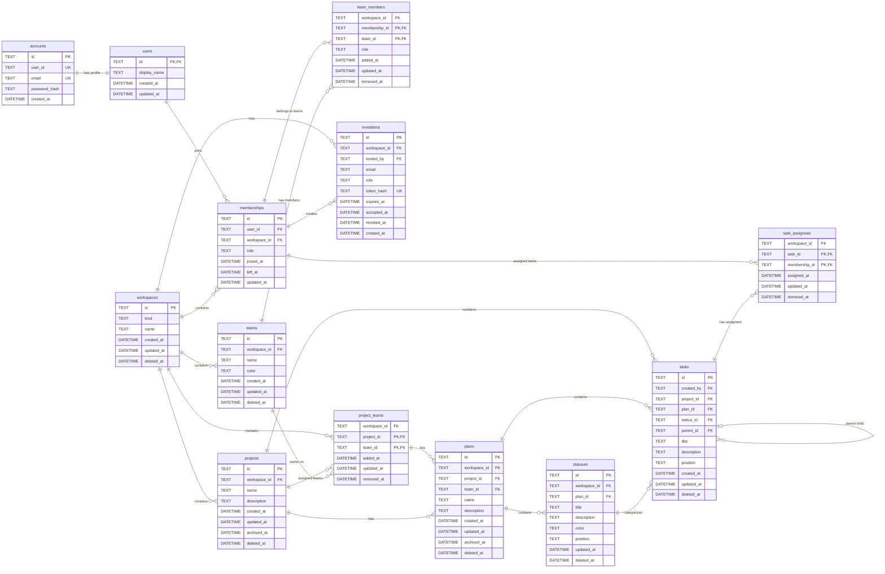

# Database Design

## Database Graph

## 1. General Structure

The same logical schema exists in two physical databases.

|          | Local                                                                                                      | Server                                                   |
| -------- | ---------------------------------------------------------------------------------------------------------- | -------------------------------------------------------- |
| Engine   | SQLite (`modernc.org/sqlite`, `database/sql`, no ORM (Object-Relational Mapping))                          | PostgreSQL                                               |
| Scope    | The user's own device                                                                                      | Team workspaces, accounts, invitations, synchronization |
| Tables   | users, workspaces, memberships, teams, team_members, projects, project_teams, plans, statuses, tasks, task_assignees | All local tables, plus accounts and invitations         |

DDL (Data Definition Language) is maintained in two separate directories: `migrations/sqlite` and `migrations/postgres`. The logical schema is the same; only type mappings and language-specific differences vary.

Assumption: For workspaces where `kind = team`, the server is the source of truth, and the local database acts as a cache. For `kind = personal` workspaces, the server is just for backing up data for synchronizing data across devices.

## 2. Concepts

| Concept    | Definition |
| ---------- | ---------- |
| User       | Identity. Even a user without an account has a user record. When an account is created, `users.id` remains unchanged, so the IDs of records associated with that user never need to be rewritten. |
| Account    | Login credentials (email address and password hash). Exists only on the server and is not synchronized. A user can have at most one account. |
| Workspace  | Authorization and synchronization boundary. A `personal` workspace has a single member and works without an account. A `team` workspace supports multiple members. Every synchronized row carries a `workspace_id`. |
| Membership | A user's role in a workspace: `owner`, `admin`, `member`, or `viewer`. Leaving a workspace is recorded using `left_at`; the row is not deleted. |
| Team       | A permanent group of people within a workspace (Backend, Frontend, Mobile). Teams are flat; nested teams are not supported. |
| Project    | A unit of work belonging to a workspace. It is associated with one or more teams and contains one or more plans. |
| Plan       | A board inside a project. `team_id IS NULL` means the plan covers the whole project; otherwise it belongs to one team of that project. Statuses and tasks belong to a plan. |
| Status     | A Kanban column belonging to a plan. The `category` field defines the column's meaning: `todo`, `in_progress`, or `done`. |
| Task       | A unit of work within a plan and a status. The owning team is derived from the plan. |

### 2.1 Team Model

Teams are scoped to a workspace, and team memberships are also scoped to a workspace. There are three distinct relationships:

| Relationship                         | Table           | Meaning |
| ------------------------------------ | --------------- | ------- |
| Which person belongs to which team  | `team_members`  | A person can belong to multiple teams. |
| Which team works on which project   | `project_teams` | A project can be associated with multiple teams, and a team can be associated with multiple projects. |
| Which team a plan is dedicated to   | `plans.team_id` | A plan has a single optional team. `NULL` means the plan covers the whole project. |

Rules:

- "Members of the Backend team on a project" are not stored in a separate table. This information is derived by joining `project_teams` with `team_members`.
- A task's team is the team of its plan. Tasks do not carry their own `team_id`.
- If work involves multiple teams, it should be split into subtasks using `parent_id`. A subtask must be in the same project as its parent but may be in a different plan, which is how a task is split across team plans. A multi-team ownership model is intentionally not supported.
- An assignee (`task_assignees`) does not have to belong to the plan's team. Enforcing this requirement would invalidate assignments when a person leaves a team.
- Limitation: Because team membership is scoped to the workspace, the model cannot express that "Alice is on the Backend team for project A but not for project B." If this requirement arises, a separate project-level membership table can be added.

## 3. Conventions

| Topic | Rule |
| ----- | ---- |
| ID | UUIDv7 (Universally Unique Identifier), generated in Go using `model.NewID()`. The database does not generate IDs. SQLite uses `TEXT`; PostgreSQL uses `uuid`. |
| Time | Always UTC. SQLite stores timestamps as RFC 3339 `TEXT` (for example, `2026-10-28T12:00:00Z`), while PostgreSQL uses `timestamptz`. Local time zones are not stored. |
| Deletion | Soft deletion. Entity tables use `deleted_at`, relationship tables use `removed_at`, and memberships use `left_at`. Projects and plans can additionally be archived with `archived_at`. Physical deletion is performed only by an explicit cleanup (purge) job. |
| Foreign key deletion behavior | `ON DELETE` is not specified; the default behavior (restricting deletion) remains in effect. |
| Re-adding relationships | If a relationship row already exists, `removed_at` is cleared instead of inserting a new row. This prevents primary key conflicts and loss of history. |
| Ordering | `position` is a fractional index stored as `TEXT`. Moving an item updates only a single row. |
| Enums | `TEXT` with a `CHECK` constraint. |
| Synchronized tables | All of them carry `workspace_id` and `updated_at`. |
| SQLite | `PRAGMA foreign_keys = ON` is specified as a DSN (Data Source Name) parameter, and tables are defined as `STRICT`. |
| Email | Stored in lowercase-normalized form. |

## 4. Consistency Rules

### 4.1 Rules Enforced by the Database

| Rule | Mechanism |
| ---- | --------- |
| A row cannot reference a row belonging to another workspace. | Composite foreign key: `(x_id, workspace_id)` → `(id, workspace_id)`. The referenced tables have a unique index on `(id, workspace_id)` to support this. |
| A plan's team must be associated with the plan's project. | `plans (project_id, team_id)` → `project_teams (project_id, team_id)`. If `team_id` is `NULL`, the constraint is not checked. |
| A plan belongs to a project of the same workspace. | `plans (project_id, workspace_id)` → `projects (id, workspace_id)`. |
| A status belongs to a plan of the same workspace. | `statuses (plan_id, workspace_id)` → `plans (id, workspace_id)`. |
| A task's status must be in the task's plan. | `tasks (status_id, plan_id)` → `statuses (id, plan_id)`. |
| A task's plan must be in the task's project. | `tasks (plan_id, project_id)` → `plans (id, project_id)`. |
| A subtask and its parent are in the same project. | `tasks (parent_id, project_id)` → `tasks (id, project_id)`. The plan may differ. |
| Plan names are unique within a project and team scope. | Partial unique index on `(project_id, COALESCE(team_id, ''), name) WHERE deleted_at IS NULL`. |
| Team names are unique within a workspace. | Partial unique index: `WHERE deleted_at IS NULL`. |
| A user can have only one membership in a given workspace. | Unique constraint on `(workspace_id, user_id)`. |
| Enum values must be valid. | `CHECK` constraint. |

### 4.2 Rules Enforced by the Service Layer

All of these rules are protected by unit tests.

| Rule | Notes |
| ---- | ----- |
| Each user can have one `personal` workspace. | Teams cannot be created in a `personal` workspace. |
| The last `owner` cannot leave or have their role downgraded. | |
| A member who has left (`left_at` is set) cannot be assigned to a team or a task. | When a member leaves, the corresponding `team_members` and `task_assignees` rows are closed within the same transaction. |
| A subtask cannot create a cycle. | |
| Creating a project creates a default whole-project plan with the default statuses. | Done in one transaction. |
| A task created without an explicit plan goes into the project's default plan. | The default plan is the oldest non-deleted, non-archived plan with `team_id IS NULL`. |
| When a team is removed from a project or deleted. | The plans of that team within the affected project are archived (`archived_at`) within the same transaction. The foreign key cannot see soft removal. |
| When a plan is deleted. | Its `statuses` and `tasks` rows are individually marked with `deleted_at` within the same transaction. |
| When a project is deleted. | Its `plans`, `statuses`, `tasks`, and `project_teams` rows are individually marked with `deleted_at` / `removed_at` within the same transaction. The system does not rely on the parent being hidden, because each row needs its own deletion record for synchronization. |
| Moving a task to another plan. | The status is mapped to a status of the target plan, because status IDs belong to a single plan. |

## 5. Table Reference

| Table          | Location | Purpose | Notes |
| -------------- | -------- | ------- | ----- |
| users          | Both     | Identity and display name | Does not contain email addresses, so user records can be safely synchronized to devices. |
| accounts       | Server   | Email address and password hash | Primary key is `user_id`; one-to-one relationship with `users`. |
| workspaces     | Both     | Authorization and synchronization boundary | `kind` cannot be changed after creation. |
| memberships    | Both     | Role connecting a user to a workspace | `created_by` and assignments reference this table. |
| teams          | Both     | Groups of people within a workspace | |
| team_members   | Both     | Team membership | `role`: `lead` or `member`. |
| projects       | Both     | Unit of work | `archived_at` indicates archival; `deleted_at` indicates deletion. |
| project_teams  | Both     | Association between a project and a team | |
| plans          | Both     | Board of a project, for the whole project or for one team | `team_id` is nullable; `archived_at` indicates archival. |
| statuses       | Both     | Kanban columns belonging to a plan | The meaning of `done` is defined by `category`. |
| tasks          | Both     | Tasks | `plan_id` and `project_id` are both stored; `parent_id` identifies a subtask. |
| task_assignees | Both     | Person assignments to tasks | |
| invitations    | Server   | Workspace invitations | The token is never stored in plaintext; only its hash is stored. |

## 6. Indexes

| Index | Purpose |
| ----- | ------- |
| `memberships (user_id)` | Find the workspaces a user belongs to. |
| `team_members (team_id)` | Find a team's members. This index is also needed because the primary key order is `(membership_id, team_id)`. |
| `project_teams (team_id)` | Find a team's projects. This index is also needed because the primary key order is `(project_id, team_id)`. |
| `plans (project_id, team_id) WHERE deleted_at IS NULL` | Find the plans of a project, optionally filtered by team. |
| `plans (project_id, COALESCE(team_id, ''), name) WHERE deleted_at IS NULL` (unique) | Plan name uniqueness per project and team scope. |
| `statuses (plan_id, position)` | Order status columns. |
| `task_assignees (membership_id) WHERE removed_at IS NULL` | Retrieve tasks assigned to the current user. |
| `tasks (parent_id)` | Find subtasks. |
| `tasks (project_id) WHERE deleted_at IS NULL` | Count and list the tasks of a project across plans. |
| `tasks (plan_id, status_id, position)` | Order tasks on a plan's board. |
| `tasks (workspace_id, updated_at)` | Retrieve changed records during synchronization. |
| `projects (workspace_id) WHERE deleted_at IS NULL` | non-deleted projects of a workspace |

## 7. Synchronization Notes

Synchronization is not implemented at this stage; the schema has been designed with it in mind. The following decisions will be made during implementation:

- `updated_at` is based on the client clock. Last-Write-Wins (LWW) conflict resolution may select the wrong winner when clocks are skewed. A monotonically increasing version number (sequence) will be maintained on the server and used as the synchronization cursor.
- `accounts` and `invitations` are not synchronized.
- AI chat tables are not synchronized. API keys are not stored in the database; they are stored in the operating system's keychain.

## 8. Out of Scope

| Topic | Reason / When to Reconsider |
| ----- | -------------------------- |
| `friendships` | To be added after the invitation flow, as a shortcut for inviting people. |
| Nested teams (`parent_team`) | Adding a `parent_id` later is inexpensive if a real need arises. |
| Project-level access control | If introduced, the synchronization filter will move from the workspace level to the project level, creating a security boundary. A `projects.visibility` column can be added later. |
| Multiple email addresses | Since `accounts.user_id` is unique, a user can have only one account. If needed, the `accounts` table can be split. |
| Multiple owning teams | Handled through subtasks in separate team plans. |
| Labels, priority, task numbers | Product features to be added at the relevant stage. |

## 9. Open Decisions

| Decision | Current Assumption |
| -------- | ------------------ |
| Task ownership | A task's team is derived from `plans.team_id`; `tasks.team_id` does not exist. |
| Plan scope | A plan is either whole-project (`team_id IS NULL`) or dedicated to one team. |
| `statuses.category` | Added; calculations for "open tasks" and progress are based on it. |
| `accounts.id` | Removed; the primary key is `user_id`. |
| Default plan | Every project gets a plan named `Main` on creation. |